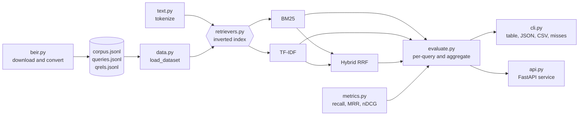

# ragbench — retrieval benchmarking for RAG

[](https://github.com/Vishal-Krishna-Kumar/ragbench/actions/workflows/ci.yml)
 

Most RAG failures are retrieval failures: the right passage never reaches the model.
**ragbench** makes retrieval quality measurable. It ships three retrievers implemented from scratch,
standard IR metrics, a CLI that prints a comparison table, and a FastAPI service you can run in Docker.

## Features
- **Retrievers (NumPy only, no ML framework):** Okapi **BM25**, sublinear **TF-IDF + cosine**, and **hybrid Reciprocal Rank Fusion** of both.
- **Metrics:** Recall@k, Precision@k, Hit@k, MRR and graded **nDCG@k**, plus mean / p95 latency per query.
- **Data format:** BEIR-style `corpus.jsonl`, `queries.jsonl`, `qrels.jsonl` (graded relevance).
- **Service:** `POST /index`, `POST /search`, `POST /evaluate`, `GET /health`, with OpenAPI docs at `/docs`.
- **Engineering:** typed code, 33 unit/integration tests, GitHub Actions CI (lint, format and type checks, tests on 3.10/3.12/3.13, Docker build and container smoke test), non-root Docker image with a health check.

## Install
```bash
pip install git+https://github.com/Vishal-Krishna-Kumar/ragbench.git
ragbench path/to/dataset            # corpus.jsonl, queries.jsonl, qrels.jsonl
ragbench-beir scifact               # fetch a public dataset into data/scifact
```

## Quick start (from a clone)
```bash
python -m venv .venv && source .venv/bin/activate      # Windows: .venv\Scripts\activate
pip install -e ".[dev]"
pytest -q                                              # 33 tests
python -m ragbench.cli data/sample                     # benchmark table
uvicorn ragbench.api:app --reload                      # API at http://localhost:8000/docs
```

Docker:
```bash
docker build -t ragbench .
docker run -p 8000:8000 ragbench
```

## Example: CLI output formats
```bash
python -m ragbench.cli data/sample                                  # Markdown table (default)
python -m ragbench.cli data/sample --format json                    # summary as JSON, for scripts and CI
python -m ragbench.cli data/sample --retrievers bm25 --format csv   # one row per retriever
python -m ragbench.cli data/sample --json results.json              # also save per-query detail to a file
python -m ragbench.cli data/sample --misses 1                       # list the queries each retriever gets wrong
```

`--misses K` answers the question a score cannot: *which* queries failed. On the sample set every retriever
misses the same query at rank 1:

```
bm25: 1 of 25
- [q21] should I fine-tune or use retrieval  ->  retrieved d25, d07, d29
```

## Example: API
```bash
curl -X POST localhost:8000/index -H "Content-Type: application/json" \
  -d '{"documents":[{"id":"a","text":"BM25 ranks by term frequency"},{"id":"b","text":"Docker builds container images"}]}'
curl -X POST localhost:8000/search -H "Content-Type: application/json" \
  -d '{"query":"container images","k":1,"retriever":"hybrid_rrf"}'
```

## Results on the bundled sample set
`data/sample` is a small, hand-written benchmark (30 cloud/ML-engineering passages, 25 queries,
graded relevance judgements written by hand — see `scripts/make_sample_data.py`).

| retriever | hit@1 | hit@3 | recall@5 | mrr | ndcg@5 | ndcg@10 |
|---|---|---|---|---|---|---|
| bm25 | 0.960 | 0.960 | 0.920 | 0.968 | 0.945 | 0.956 |
| tfidf | 0.960 | 0.960 | 0.920 | 0.968 | 0.943 | 0.955 |
| hybrid_rrf | 0.960 | 0.960 | 0.920 | 0.968 | 0.943 | 0.955 |

**Honest read:** the sample queries share vocabulary with their passages, so lexical retrievers do well and
fusion adds little here. The value of the tool is running the same harness on *your* corpus, where
paraphrased queries expose lexical-retrieval gaps — the case dense embeddings and hybrid search are for.

## Results on a public dataset (BEIR SciFact)
The sample set is tiny, so the same harness was run on [SciFact](https://github.com/beir-cellar/beir) from the
BEIR benchmark: 5,183 scientific abstracts and 300 test queries with expert relevance judgements.

```bash
python -m ragbench.beir scifact --out data/scifact   # download and convert (about 3 MB)
python -m ragbench.cli data/scifact
```

| retriever | hit@1 | hit@3 | recall@5 | mrr | ndcg@5 | ndcg@10 | mean latency (ms) |
|---|---|---|---|---|---|---|---|
| bm25 | 0.527 | 0.677 | 0.698 | 0.611 | 0.620 | 0.647 | 0.20 |
| tfidf | 0.463 | 0.667 | 0.703 | 0.570 | 0.590 | 0.612 | 0.27 |
| hybrid_rrf | 0.493 | 0.667 | 0.702 | 0.593 | 0.608 | 0.635 | 0.82 |

**Honest read:** BM25 is the best of the three on ranking quality, and fusing it with TF-IDF lowers nDCG and MRR
slightly (recall@10 goes the other way, 0.783 against 0.774). RRF helps most when the fused rankers make
different mistakes, and these two are both lexical. Latency was measured on a laptop and will differ on
other hardware; the quality numbers are deterministic.

### Inverted index: same rankings, far less time and memory
Both retrievers originally scored every document for every query, and TF-IDF kept a dense
documents x vocabulary matrix. They now store postings (`term -> document indices and weights`) and only
touch the documents that contain a query term. Measured on SciFact, same machine, before and after:

| | before | after |
|---|---|---|
| TF-IDF mean query latency | 216.43 ms | 0.22 ms |
| TF-IDF index build | 75.9 s | 11.9 s |
| TF-IDF peak memory while indexing | 4,142 MB | 123 MB |
| BM25 mean query latency | 21.14 ms | 0.38 ms |
| BM25 index build | 1.6 s | 4.3 s |
| Full three-retriever benchmark run | 3 min 17 s | 9 s |

The top-10 results are identical for all 300 queries with both retrievers. BM25 indexing became slower
because the postings are built in pure Python; that is the remaining cost.

`python -m ragbench.beir <name>` works for other BEIR datasets that use the same layout (for example
`nfcorpus` or `fiqa`).

## Use it as a library
```python
from ragbench.data import load_dataset
from ragbench.evaluate import evaluate_retriever, missed_queries
from ragbench.retrievers import make_retriever

r = make_retriever("hybrid_rrf").fit(
    ["a", "b"], ["BM25 ranks by term frequency", "Docker builds container images"]
)
r.search("container images", k=1)  # [('b', 0.03278688524590164)]

ds = load_dataset("data/sample")
res = evaluate_retriever(make_retriever("bm25").fit(ds.doc_ids, ds.docs), ds.queries, ds.qrels)
res["metrics"]["ndcg@10"]  # 0.956
[m["query_id"] for m in missed_queries(res, ds.queries, k=1)]  # ['q21']
```

## How it fits together


Every retriever exposes the same two methods, `fit(doc_ids, docs)` and `search(query, k)`, so the
evaluator, the CLI and the API never need to know which one they are running.

## Project layout
```
ragbench/
  text.py         tokenisation shared by all retrievers
  retrievers.py   BM25, TF-IDF, hybrid RRF (common fit/search interface)
  metrics.py      recall, precision, hit rate, MRR, nDCG
  evaluate.py     per-query + aggregate evaluation with latency
  data.py         BEIR-style dataset loader with validation
  beir.py         download a public BEIR dataset and convert it
  api.py          FastAPI service
  cli.py          benchmark CLI
tests/            metrics, retrievers, CLI, BEIR conversion, API
```

## Roadmap
- Dense retriever plug-in (sentence-transformers / OpenAI embeddings) behind the same interface.
- Cross-encoder reranking stage and per-stage latency budget.
- Answer-level faithfulness scoring for the generation step.

## Contributing
Bug reports, new retrievers and new metrics are welcome. See [CONTRIBUTING.md](CONTRIBUTING.md) for setup,
checks and how to add a retriever.

## License
MIT
